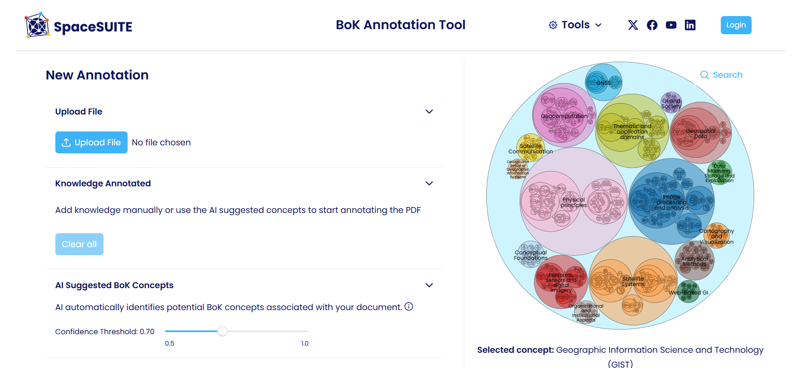
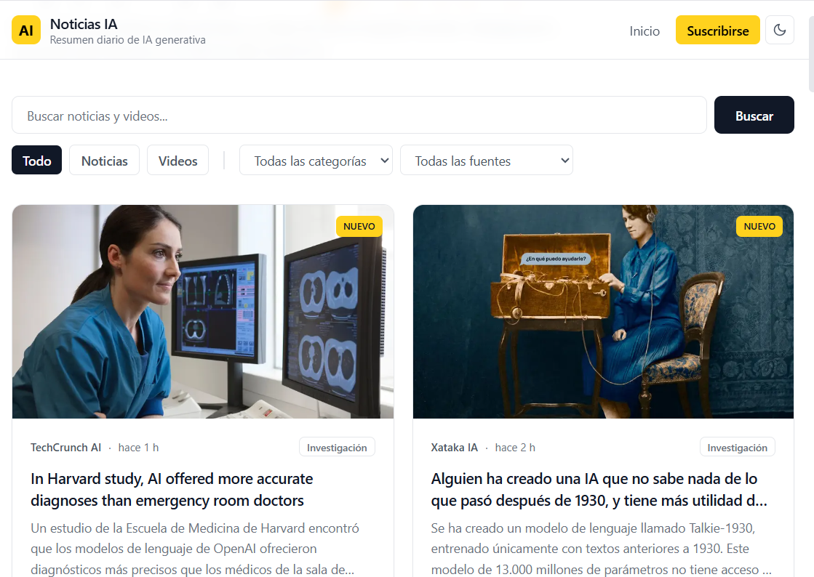
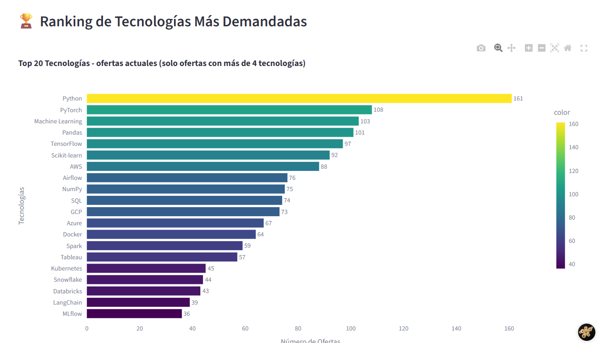

  

 

<h3>
  🌟 Projects
   
  
</h3>

<!-- ================= FEATURED PROJECT ================= -->

<h3>
  🛰️ SpaceSuite - BoK Annotation Tool
</h3>

  

  
  
  
  

  <strong>
    Browser-based AI tool for PDF analysis and knowledge mapping
    against the GeoSpace Body of Knowledge (BoK).
  </strong>

  

 

<!-- ================= SECONDARY PROJECTS ================= -->

<table>
<tr>
<td width="50%" valign="top">

<h3>
  📰 AI Newsletter
</h3>

  
  

  Automated platform that collects and summarizes content about Generative AI.

  

</td>
<td width="50%" valign="top">

<h3>
  📊 Data Science Jobs Analytics
</h3>

  
  

  Interactive analysis of the Data Science job market and technical skills demand.

  

</td>
</tr>
</table>

<h3>
  🧰 Tech Stack
   
  
</h3>

**PROGRAMMING LANGUAGES**

**LIBRARIES & TOOLS**

**CLOUD COMPUTING**

**VERSION CONTROL**

<h3>
  📈 GitHub Stats
   
  
</h3>

  
  

